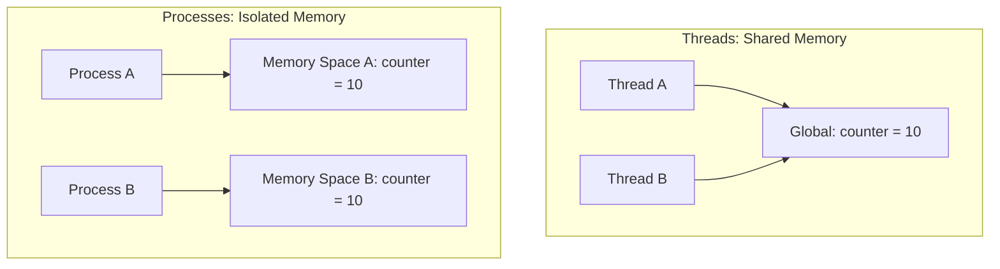

# Multiprocessing Module: Bypassing the GIL for CPU-Bound Tasks

For CPU-bound tasks—such as parsing massive log files using complex regular expressions, performing data compression, or executing cryptographic operations—Python threads cannot run in parallel due to the Global Interpreter Lock (GIL).

To achieve true parallelism and utilize multiple CPU cores, use Python's built-in **`multiprocessing`** module. Instead of threads, this module spawns separate operating system processes, each with its own Python interpreter and memory space, effectively bypassing the GIL.

In this guide, we will cover the isolated memory model of processes, communicate between processes using queues, and write a parallel log analyzer using `ProcessPoolExecutor`.

---

## The Multiprocessing Memory Model

Unlike threads, which share the same memory space, processes are isolated from one another:



If Process A modifies `counter = 11`, Process B's copy remains `10`. To share data between processes, you must use specific communication channels like **`multiprocessing.Queue`**.

---

## 1. Process Communication using Queues

A `multiprocessing.Queue` is a thread- and process-safe first-in, first-out (FIFO) queue. It serializes objects using the `pickle` module to transmit them across process boundaries.

```python
import time
from multiprocessing import Process, Queue

def worker_process(task_queue, result_queue):
    """
    Consumes tasks from task_queue and puts results into result_queue.
    """
    while not task_queue.empty():
        try:
            task = task_queue.get_nowait()
            print(f"Processing task: {task}...")
            # Simulate work
            time.sleep(0.5)
            result_queue.put(f"Result: {task} processed")
        except Exception:
            break

def run_queue_orchestration():
    task_q = Queue()
    result_q = Queue()
    
    # 1. Populate tasks
    for i in range(5):
        task_q.put(f"Task-{i}")
        
    # 2. Spawn worker processes
    processes = []
    for _ in range(2):
        p = Process(target=worker_process, args=(task_q, result_q))
        processes.append(p)
        p.start() # Spawn OS process
        
    # 3. Wait for all processes to finish
    for p in processes:
        p.join()
        
    # 4. Print results
    while not result_q.empty():
        print(result_q.get())

if __name__ == "__main__":
    run_queue_orchestration()
```

---

## 2. Using `concurrent.futures.ProcessPoolExecutor`

To execute CPU-bound tasks in parallel, use the **`ProcessPoolExecutor`** class. It manages a pool of worker processes, distributes tasks, and handles execution details.

Here is a parallel log parsing script:

```python
# Save this file as parallel_log_parser.py
import re
from concurrent.futures import ProcessPoolExecutor, as_completed

def search_errors_in_chunk(log_lines):
    """
    CPU-bound log parser. Scans a list of lines for error patterns.
    """
    error_pattern = re.compile(r"\[(ERROR|CRITICAL)\]")
    results = []
    
    for line in log_lines:
        match = error_pattern.search(line)
        if match:
            results.append(line)
            
    return results

def run_parallel_analysis():
    # Simulate a massive log file (1 million lines)
    raw_lines = ["[INFO] User login success."] * 999990 + ["[ERROR] Database timeout."] * 10
    
    # 1. Partition the lines into 4 chunks to distribute across 4 worker processes
    chunk_size = len(raw_lines) // 4
    chunks = [raw_lines[i:i + chunk_size] for i in range(0, len(raw_lines), chunk_size)]
    
    print("Starting parallel log analysis using ProcessPoolExecutor...")
    
    # Initialize the process pool
    with ProcessPoolExecutor(max_workers=4) as executor:
        # submit() schedules the function for execution on a worker process
        futures = [
            executor.submit(search_errors_in_chunk, chunk) 
            for chunk in chunks
        ]
        
        compiled_errors = []
        for future in as_completed(futures):
            try:
                results = future.result()
                compiled_errors.extend(results)
            except Exception as e:
                print(f"Worker execution failed: {e}")
                
    print(f"✅ Analysis complete. Total critical errors found: {len(compiled_errors)}")

if __name__ == "__main__":
    # On Windows, ProcessPoolExecutor execution must be protected by main block
    # to prevent recursive subprocess spawns.
    run_parallel_analysis()
```

---

## Summary

The `multiprocessing` module allows you to bypass the GIL and execute CPU-bound tasks in parallel. By partitioning data and distributing the work across multiple processes using `ProcessPoolExecutor`, you can utilize multiple CPU cores and speed up data-intensive scripts. In the next section, we will cover **asyncio basics**.
