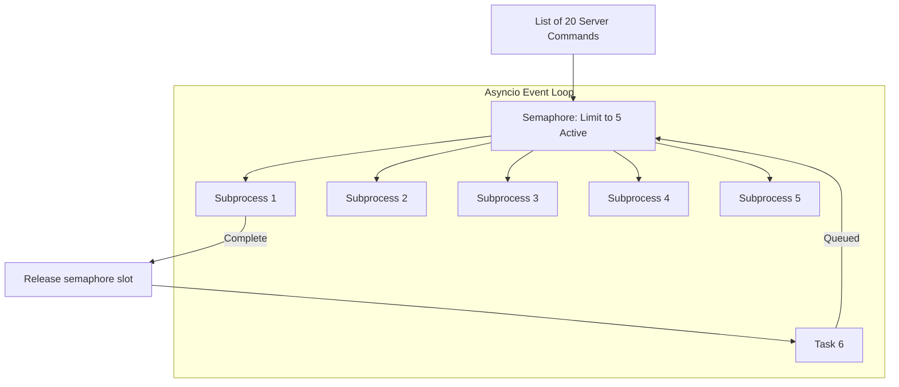

# Async for DevOps: Parallel CLI Runs and Rate Limiting

In DevOps automation, you frequently run network operations and CLI tasks concurrently. For example, you might need to query the status of 50 Kubernetes pods, check SSL certificate expirations across 100 domains, or run a security audit tool against multiple server groups.

However, running these operations concurrently without control can overload your systems or trigger rate limits. 

To manage this, you can combine **Asynchronous Subprocesses** (using `asyncio.create_subprocess_exec`) with **Semaphores** to limit concurrency (e.g., executing no more than 5 commands at a time).

In this guide, we will write asynchronous CLI command wrappers, manage task concurrency using semaphores, and build a parallel log parser.

---

## Controlled Concurrency Pipeline



---

## 1. Asynchronous Subprocesses in Python

The standard `subprocess.run()` function is blocking. To run CLI commands concurrently within an event loop, use **`asyncio.create_subprocess_exec`** to spawn commands on background processes and await their execution.

```python
import asyncio

async def run_async_command(cmd_args):
    # Spawn the process asynchronously
    process = await asyncio.create_subprocess_exec(
        *cmd_args,
        stdout=asyncio.subprocess.PIPE,
        stderr=asyncio.subprocess.PIPE
    )
    
    # Wait for completion and read output
    stdout, stderr = await process.communicate()
    
    return process.returncode, stdout.decode().strip()
```

---

## 2. Managing Concurrency with `asyncio.Semaphore`

If you trigger 100 subprocesses concurrently, your system may run out of memory or file descriptors. Use an **`asyncio.Semaphore`** to limit the number of concurrent tasks. A semaphore acts as a gatekeeper: it allows only a configured number of tasks to pass, queuing the rest.

```python
# Initialize semaphore to allow maximum 3 tasks concurrently
sem = asyncio.Semaphore(3)

async def worker_with_limit(name):
    # Acquire slot
    async with sem:
        print(f"Task '{name}' enters active run...")
        await asyncio.sleep(2) # Simulate work
        print(f"Task '{name}' completed.")
```

---

## 3. Practical Example: Parallel Server Status Checker

Here is a script that runs diagnostic commands across multiple servers concurrently while limiting execution to 5 concurrent tasks using a semaphore:

```python
# Save this file as parallel_diagnostics.py
import asyncio
import time

# 1. Define target hosts to audit
TARGET_SERVERS = [
    "server-us-01", "server-us-02", "server-eu-01", "server-eu-02",
    "server-ap-01", "server-ap-02", "server-sa-01", "server-sa-02",
    "server-af-01", "server-af-02"
]

# 2. Limit concurrency to 3 tasks to prevent system overload
concurrency_limit = asyncio.Semaphore(3)

async def check_server_ping(server, semaphore):
    """
    Spawns an asynchronous ping process to check server status.
    """
    async with semaphore:
        print(f"▶️ Starting diagnostic ping to: {server}...")
        
        # command: ping -c 1 <server> (on Linux) or -n 1 (on Windows)
        cmd = ["ping", "-c", "1", server] if time.name != "nt" else ["ping", "-n", "1", server]
        
        try:
            # Spawn the subprocess
            process = await asyncio.create_subprocess_exec(
                *cmd,
                stdout=asyncio.subprocess.PIPE,
                stderr=asyncio.subprocess.PIPE
            )
            
            # Await execution with a 5-second timeout
            # We wrap the communication in wait_for to handle hanging sockets
            stdout_bytes, stderr_bytes = await asyncio.wait_for(
                process.communicate(),
                timeout=5.0
            )
            
            stdout = stdout_bytes.decode(errors="ignore")
            exit_code = process.returncode
            
            if exit_code == 0:
                return server, "ONLINE", ""
            else:
                return server, "OFFLINE", "Ping command returned non-zero code."
                
        except asyncio.TimeoutError:
            return server, "TIMEOUT", "Ping connection attempt timed out."
        except Exception as e:
            return server, "ERROR", str(e)

async def main():
    start_time = time.perf_counter()
    print(f"Orchestrating diagnostic audit on {len(TARGET_SERVERS)} nodes...")
    
    # 3. Compile task list, passing the shared semaphore to each task
    tasks = [
        check_server_ping(server, concurrency_limit) 
        for server in TARGET_SERVERS
    ]
    
    # 4. Execute all tasks concurrently
    results = await asyncio.gather(*tasks)
    
    print("\n==================================================")
    print("📋 PARALLEL DIAGNOSTIC SUMMARY")
    print("==================================================")
    for server, status, error in results:
        status_color = "✅" if status == "ONLINE" else "❌"
        err_msg = f" (Error: {error})" if error else ""
        print(f"{status_color} Server: {server:<15} | Status: {status}{err_msg}")
        
    duration = time.perf_counter() - start_time
    print(f"\nAudit completed in: {duration:.2f} seconds")

if __name__ == "__main__":
    # Ensure Windows asyncio loop handles subprocesses correctly
    import sys
    if sys.platform == "win32":
        asyncio.set_event_loop_policy(asyncio.WindowsProactorEventLoopPolicy())
        
    asyncio.run(main())
```

---

## Summary

`asyncio` allows you to execute CLI commands and network operations concurrently within your DevOps pipelines. By combining asynchronous subprocesses (`create_subprocess_exec`) with `asyncio.Semaphore` to limit concurrency, you can build efficient, safe automation scripts. This completes **Chapter 53 - Performance and Optimization**. In the next chapter, we will explore **Production Best Practices**.
