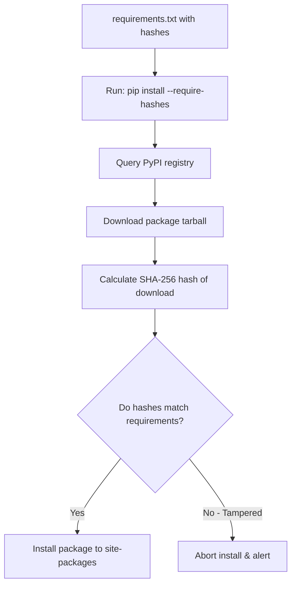

# Dependency Management: Pip, Requirements, and Lock Files

When writing automation scripts, you will inevitably import third-party packages (such as `boto3`, `requests`, or `pyyaml`). 

If you do not manage these dependencies correctly, your scripts will eventually fail in production. A library update might introduce a breaking API change, or an unpinned package could install a compromised version.

To ensure your scripts are reproducible and secure:
1. **Pin Versions**: Specify exact package versions in your dependency configurations.
2. **Use Lock Files**: Lock nested sub-dependencies to guarantee that the exact same package versions are installed on every system.
3. **Verify Hashes**: Use cryptographic hashes to verify that package files have not been modified.

In this guide, we will compare dependency managers, examine pinning syntax, configure hash verification, and write a secure dependency config.

---

## Dependency Ingestion Flow



---

## Dependency Managers Comparison

| Dependency Manager | Configuration Format | Lock File Support | Best Use Case |
| :--- | :--- | :--- | :--- |
| **`pip`** | `requirements.txt` | Custom setup (via `pip-compile`). | Lightweight scripts and container environments. |
| **`Pipenv`** | `Pipfile` | Yes (`Pipfile.lock`). | Application development. |
| **`Poetry`** | `pyproject.toml` | Yes (`poetry.lock`). | Package publishing and complex dependency resolution. |

---

## 1. Pinning Syntax in `requirements.txt`

To prevent scripts from installing new versions automatically, use comparison operators to pin dependencies:

* **`==`**: Install the exact specified version (standard for production).
  ```text
  requests==2.31.0
  ```
* **`>=`**: Install version equal to or greater than specified.
  ```text
  requests>=2.30.0
  ```
* **`~=`**: Install compatible release (upgrades patch versions, blocks minor/major version upgrades).
  ```text
  # Allows 2.31.1 through 2.31.x, blocks 2.32.0
  requests~=2.31.0
  ```

---

## 2. Enforcing Integrity Checks with Hash Verification

To protect your pipelines against supply chain attacks (where an attacker compromises a library registry and replaces a secure package with a malicious one), pin your packages using **cryptographic SHA-256 hashes**.

You can generate these hashes automatically using the `pip-tools` utility:
```bash
pip install pip-tools
pip-compile --generate-hashes requirements.in
```

This compiles a secure, hash-constrained `requirements.txt` file:

```text
# requirements.txt
# Generated via pip-compile --generate-hashes
#
requests==2.31.0 \
    --hash=sha256:58cd26c697d6bf17465b8400896171f521152a248a9121804c02360b2e1f2f34 \
    --hash=sha256:942334fe758aaab14e0c608b1399f4be671f1b9050ac940b490f19eecac03a11
urllib3==2.0.7 \
    --hash=sha256:f02a5cf34bdbee53adcd9723049b4009695a4f669db7bc954316d97a9f77f6b2
```

To install this file and enforce hash verification:

```bash
pip install --require-hashes -r requirements.txt
```
If a downloaded package file's SHA-256 hash does not match the configured hash, the installation will abort, protecting your pipeline.

---

## Summary

Managing dependencies with version pinning and hash verification is essential for writing stable, secure Python scripts. By using tools like `pip-compile` to generate lock files containing cryptographic hashes, you can prevent production failures and secure your software supply chain. In the next section, we will cover **packaging scripts**.
