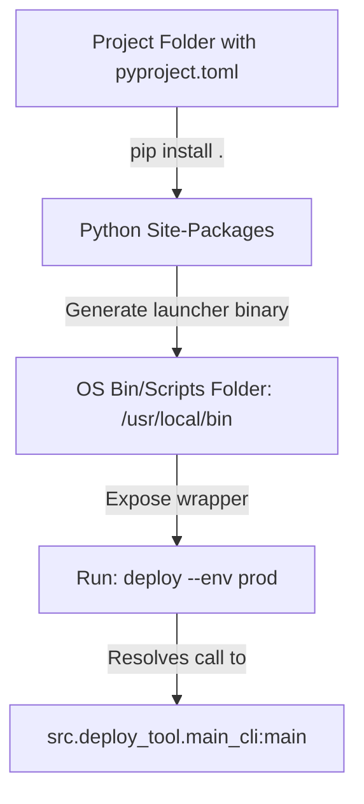

# Packaging Scripts: Pyproject.toml and Console Scripts

When sharing automation tools with your team, distributing loose script files (like `deploy.py`) can lead to issues. Developers have to navigate to the script directory, locate the correct virtual environment, and execute the file using the Python interpreter:
```bash
python /path/to/script/deploy.py --help
```

A better approach is to **Package** your scripts. By configuring standard Python packaging metadata, you can allow developers to install your tools globally and run them as native shell commands (e.g. `deploy --help`) from any directory.

In this guide, we will configure project metadata using the modern **`pyproject.toml`** configuration format (defined in PEP 621), map CLI entry points using **`console_scripts`**, and install local packages in editable development mode.

---

## Packaging and Entry Point Architecture



---

## 1. Project Directory Structure

To package your tools, organize your project files in this directory layout:

```text
my-cli-tool/
├── pyproject.toml         # Packaging metadata config
├── README.md              # Project description file
└── src/                   # Source code
    └── my_tool/
        ├── __init__.py
        └── main.py        # Contains the target CLI function
```

---

## 2. Configuring Project Metadata in `pyproject.toml`

The `pyproject.toml` file is the modern standard for configuring Python packaging metadata, replacing legacy `setup.py` files.

Here is a `pyproject.toml` configuration template:

```toml
[build-system]
requires = ["setuptools>=61.0.0", "wheel"]
build-backend = "setuptools.build_meta"

[project]
name = "devops-cli-tools"
version = "1.0.0"
description = "A suite of automation and system checking CLI tools."
readme = "README.md"
requires-python = ">=3.10"
dependencies = [
    "click>=8.0.0",
    "requests>=2.31.0"
]

# Configure Console Script Entry Points
# Format: command_name = package.module:function_name
[project.scripts]
devops-ping = "my_tool.main:execute_ping"
```
*When this package is installed, the packaging engine automatically compiles a launcher binary named `devops-ping` that calls the `execute_ping` function in `src/my_tool/main.py`.*

---

## 3. The Entry Point Code Implementation

Here is the code inside your source module:

```python
# Save this file as src/my_tool/main.py
import sys

def execute_ping():
    """
    Main entry point function mapped in pyproject.toml.
    """
    print("🚀 Initializing diagnostic ping check...")
    
    # Process arguments, run checks...
    sys.exit(0)
```

---

## 4. Installing and Testing Packages Locally

To test your package locally during development, install it in **Editable Mode** (`-e` or `--editable`):

```bash
pip install -e .
```
Editable mode installs references pointing to your local source code directory instead of copying files. Any code edits you make in the `src/` directory apply immediately without requiring a re-installation.

Once installed, verify the command is available in your shell:
```bash
devops-ping
```

---

## Summary

Packaging Python scripts allows you to distribute your automation tools as native command-line utilities. By using the standard `pyproject.toml` metadata format and mapping entry points under the `[project.scripts]` section, you can build tools that install easily on developer laptops and production servers. In the next section, we will cover **Docker for Python scripts**.
