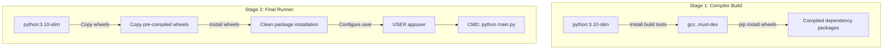

# Containerizing Python Scripts with Multi-Stage Dockerfiles

Deploying Python scripts directly to production servers can lead to issues with conflicting system packages, missing runtime libraries, and incompatible Python versions.

To ensure your scripts run consistently across all environments, use **Docker** to containerize them. A Docker image packages your Python interpreter, code files, system packages, and dependencies into a single, isolated container.

To write production-grade Dockerfiles, you should:
1. **Use Multi-Stage Builds**: Separate the compilation phase (which requires compilers like `gcc` or development libraries) from the final run phase to reduce image size.
2. **Enforce Security Boundaries**: Never run containers as the default `root` user.
3. **Configure Python Environments**: Enable flags like `PYTHONUNBUFFERED` to ensure log outputs stream to the console in real time.

In this guide, we will design a multi-stage Dockerfile and write configurations to secure container executions.

---

## Multi-Stage Build Architecture



---

## 1. Environment Variable Flags for Python Containers

When running Python inside a container, define these environment variables in your Dockerfile to optimize logging and performance:

* **`PYTHONDONTWRITEBYTECODE=1`**: Prevents Python from writing `.pyc` files to disk inside the container, saving space.
* **`PYTHONUNBUFFERED=1`**: Disables stdout buffering, ensuring print statements and log lines write immediately to standard output so they can be captured by log shippers.

---

## 2. The Production-Grade Multi-Stage Dockerfile

Here is a secure, multi-stage Dockerfile for containerizing Python scripts:

```dockerfile
# ==========================================
# STAGE 1: Compilation Build
# ==========================================
FROM python:3.10-slim AS builder

WORKDIR /build

# Install build dependencies
RUN apt-get update && apt-get install -y --no-install-recommends \
    build-essential \
    && rm -rf /var/lib/apt/lists/*

# Copy dependencies list
COPY requirements.txt .

# Compile wheels locally inside build folder to avoid polluting the final image
RUN pip wheel --no-cache-dir --no-deps --wheel-dir /build/wheels -r requirements.txt

# ==========================================
# STAGE 2: Final Runtime
# ==========================================
FROM python:3.10-slim AS runner

# Configure Python runtime settings
ENV PYTHONDONTWRITEBYTECODE=1 \
    PYTHONUNBUFFERED=1

WORKDIR /app

# Create a non-privileged system user to run the script
RUN groupadd -g 10001 appgroup && \
    useradd -u 10001 -g appgroup -m -s /bin/bash appuser

# Copy pre-compiled wheels from builder stage
COPY --from=builder /build/wheels /app/wheels
COPY requirements.txt .

# Install the wheels locally using pip
RUN pip install --no-cache-dir --no-index --find-links=/app/wheels -r requirements.txt && \
    rm -rf /app/wheels

# Copy application source code
COPY ./src /app

# Change ownership of the directory to the non-root user
RUN chown -R appuser:appgroup /app

# Switch context to the non-root user
USER appuser

# Define the container entry point
CMD ["python", "main.py"]
```

---

## Summary

Containerizing Python scripts with Docker isolates runtime dependencies and ensures consistent execution across environments. By using multi-stage builds to minimize image sizes, configuring Python flags for real-time logging, and running containers as non-root users, you can build secure, production-grade containers. In the next section, we will cover **environment management**.
