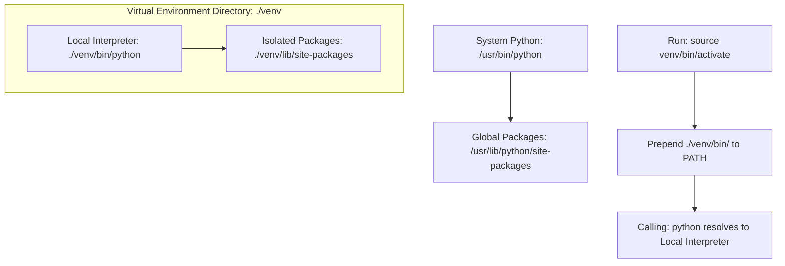

# Environment Management: Virtual Environments and Venv

When developing Python scripts, installing third-party libraries globally on your operating system is an anti-pattern. If two scripts require different versions of the same library (e.g. Script A needs `requests==2.20.0` and Script B needs `requests==2.31.0`), installing them globally will cause version conflicts.

To prevent this, use **Virtual Environments**. A virtual environment is an isolated directory containing a copy of the Python interpreter, pip package manager, and its own package directory (`site-packages`).

In this guide, we will cover how virtual environments work, manage them using Python's built-in **`venv`** module, and write an orchestration script to bootstrap environments programmatically.

---

## Virtual Environment Isolation

When you activate a virtual environment, the system modifies your shell path environment variable:



---

## 1. Creating and Activating Virtual Environments

Use Python's built-in `venv` module to create a virtual environment in your project directory:

```bash
python -m venv venv
```
This command creates a directory named `venv/` containing the isolated environment.

### Activating the Environment
To configure your active shell session to use the virtual environment, run the activation script:

* **Linux / macOS**:
  ```bash
  source venv/bin/activate
  ```
* **Windows (PowerShell)**:
  ```powershell
  .\venv\Scripts\Activate.ps1
  ```
* **Windows (Command Prompt)**:
  ```cmd
  .\venv\Scripts\activate.bat
  ```

Once activated, your terminal prompt will display the environment prefix (e.g. `(venv)`) indicating that the local Python interpreter is in use.

To exit the virtual environment:
```bash
deactivate
```

---

## 2. Programmatically Bootstrapping Virtual Environments

Here is an orchestration script that programmatically creates a virtual environment, installs requirements using pip, and verifies the setup:

```python
import os
import sys
import subprocess
import venv

def bootstrap_venv(target_directory):
    """
    Programmatically creates a virtual environment and installs dependency packages.
    """
    venv_dir = os.path.join(target_directory, "venv")
    
    # 1. Create the virtual environment
    # with_pip=True ensures pip is installed inside the environment
    print(f"Creating virtual environment in: {venv_dir}...")
    venv.create(venv_dir, with_pip=True)
    print("✅ Virtual environment created.")

    # 2. Resolve paths to virtual env binaries
    # Windows uses 'Scripts' directory, while Linux/macOS uses 'bin'
    if os.name == "nt":
        pip_path = os.path.join(venv_dir, "Scripts", "pip.exe")
        python_path = os.path.join(venv_dir, "Scripts", "python.exe")
    else:
        pip_path = os.path.join(venv_dir, "bin", "pip")
        python_path = os.path.join(venv_dir, "bin", "python")

    # 3. Install requirements using the virtual env's pip binary
    # This prevents installing packages in the global Python environment
    requirements_file = os.path.join(target_directory, "requirements.txt")
    
    if os.path.exists(requirements_file):
        print(f"Installing dependencies from {requirements_file}...")
        try:
            subprocess.run(
                [pip_path, "install", "--no-cache-dir", "-r", requirements_file],
                check=True
            )
            print("✅ Dependencies installed successfully.")
        except subprocess.CalledProcessError as e:
            print(f"❌ Failed to install dependencies: {e}")
            return False
    else:
        print("ℹ️ requirements.txt not found. Skipping dependency installation.")

    # 4. Verify the isolated environment setup
    print("\nVerifying virtual env setup...")
    result = subprocess.run(
        [python_path, "-c", "import sys; print(f'Isolated Python path: {sys.prefix}')"],
        capture_output=True,
        text=True
    )
    print(result.stdout.strip())
    return True

# Example:
# bootstrap_venv(".")
```

---

## Summary

Managing Python environments with virtual environments isolates dependencies and prevents configuration conflicts. By using the built-in `venv` module and automating environment creation, you can ensure your scripts run consistently across all platforms. In the next section, we will cover **version control for scripts**.
