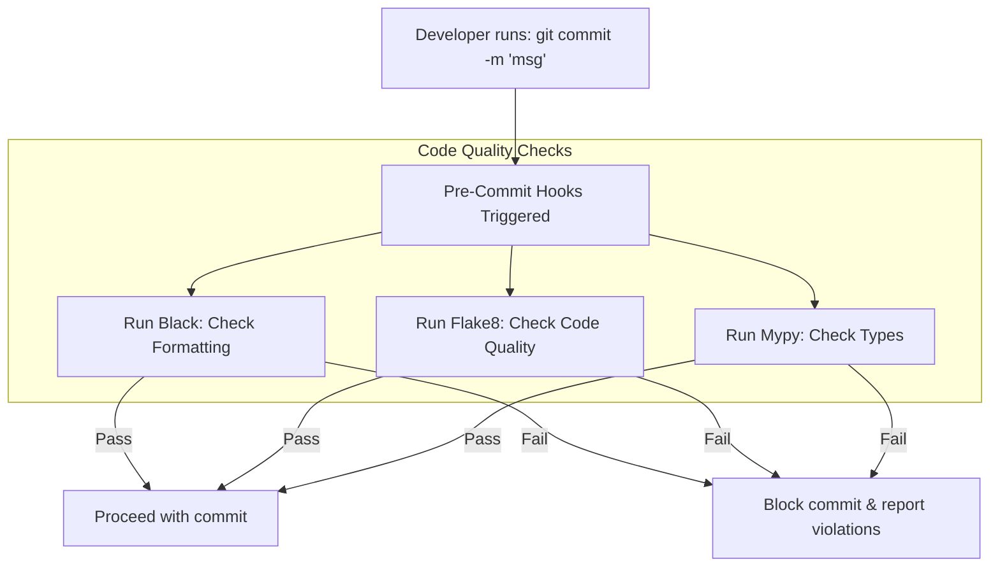

# Version Control for Scripts: Gitignore and Pre-Commit Hooks

Automation scripts must be managed in version control systems like **Git** using the same standards as application code:
* **Branch Isolation**: Never commit changes directly to the `main` branch. Use feature branches and pull requests.
* **Exclude Clutter and Secrets**: Prevent virtual environments, test coverage reports, local configurations, and sensitive credentials from entering your repository history.
* **Automate Quality Checks**: Enforce code formatters and linters automatically before code is committed using **Pre-Commit Hooks**.

In this guide, we will design a Python `.gitignore` configuration file, configure automated code checks using `pre-commit`, and write a pipeline validation yaml file.

---

## Pre-Commit Hooks Lifecycle



---

## 1. Structuring `.gitignore` for Python Projects

To prevent local runtime artifacts and sensitive configuration details from entering your Git history, create a **`.gitignore`** file in the project root:

```text
# ==========================================
# Python Runtime Artifacts
# ==========================================
__pycache__/
*.py[cod]
*$py.class
*.so
.Python
build/
develop-eggs/
dist/
downloads/
eggs/
.eggs/
lib/
lib64/
parts/
sdist/
var/
wheels/
*.egg-info/
.installed.cfg
*.egg

# ==========================================
# Virtual Environments
# ==========================================
venv/
.venv/
env/
.env/
ENV/
pip-log.txt
pip-delete-this-directory.txt

# ==========================================
# Configurations & Local Secrets (CRITICAL)
# ==========================================
.env
*.tfvars
*.tfvars.json
secrets.yaml
id_rsa
*.pem
credentials.json

# ==========================================
# Testing & Code Coverage Reports
# ==========================================
.htmlcov/
.tox/
.nosetests/
.pytest_cache/
.mypy_cache/
htmlcov/
.coverage
.coverage.*
nosetests.xml
coverage.xml
tests/results/*

# ==========================================
# Local System Log Files
# ==========================================
*.log
logs/
```

---

## 2. Automating Code Quality with Pre-Commit Hooks

To ensure your code meets quality standards before it is committed, use the **`pre-commit`** framework to run formatters and linters automatically during the Git commit process.

Install the tool:
```bash
pip install pre-commit
```

Create a **`.pre-commit-config.yaml`** configuration file in the project root:

```yaml
# Configuration details for Git Pre-Commit Hooks
repos:
  # 1. Standard hooks for formatting checks
  - repo: https://github.com/pre-commit/pre-commit-hooks
    rev: v4.4.0
    hooks:
      - id: trailing-whitespace
      - id: end-of-file-fixer
      - id: check-yaml
      - id: check-added-large-files

  # 2. Black Formatter Integration
  - repo: https://github.com/psf/black
    rev: 23.3.0
    hooks:
      - id: black
        args: [--line-length=88]

  # 3. Flake8 Linter Integration
  - repo: https://github.com/pycqa/flake8
    rev: 6.0.0
    hooks:
      - id: flake8
        args: [--max-line-length=88]
```

To install the hooks into your local Git repository configuration:
```bash
pre-commit install
```

When you run `git commit`, the pre-commit hook suite will execute. If any checks fail (e.g. Flake8 finds an unused import), the commit is blocked, allowing you to fix the issues before committing.

---

## Summary

Enforcing version control standards keeps your scripting repository clean and secure. By using a detailed `.gitignore` file to prevent credential leaks and configuring `pre-commit` hooks to run formatters and linters automatically, you can maintain code quality across your team. In the next section, we will cover **project structures**.
