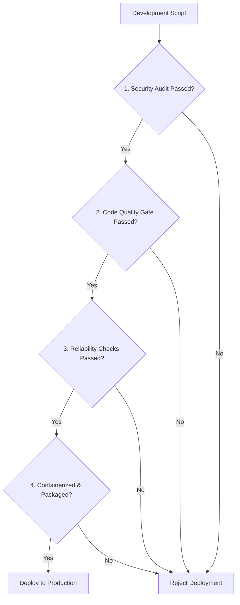

# Production Checklist: Guidelines for Deployment-Ready Scripts

Before deploying an automation script to production servers, you should run it through a quality control check. An unverified script can cause outages, leak credentials, or fail under production loads.

A **Production Checklist** provides a structured list of validation steps to ensure your scripts are secure, performant, and maintainable.

In this guide, we will outline the production checklist requirements, covering security audits, code quality gates, reliability checks, and packaging configurations.

---

## The Production Quality Gate

---

## 1. Phase 1: Security Audit

Security is the most critical phase. Vulnerable scripts can compromise your entire infrastructure.

| Verification Step | Done | Remediation Action |
| :--- | :---: | :--- |
| **No Hardcoded Secrets** | `[ ]` | Scan code for passwords or tokens. Retrieve credentials using AWS Secrets Manager, Vault, or environment variables. |
| **Safe Subprocesses** | `[ ]` | Ensure all `subprocess.run()` calls pass arguments as list matrices (e.g. `["cmd", "arg"]`) and avoid using `shell=True`. |
| **Restricted Key Files** | `[ ]` | Set private key and certificate file permissions to chmod `600` (read/write restricted to owner only). |
| **Redacted Logs** | `[ ]` | Ensure filters are configured to mask sensitive data (passwords, credit cards) before writing to log files. |

---

## 2. Phase 2: Code Quality & Verification

Ensuring code meets style and testing standards prevents syntax errors and logical bugs.

| Verification Step | Done | Remediation Action |
| :--- | :---: | :--- |
| **Style Formatting** | `[ ]` | Run the `Black` formatter to normalize code layout. |
| **Linter Checks** | `[ ]` | Execute `Flake8` and `Pylint` to scan for logical bugs and unused imports. |
| **Type Checks** | `[ ]` | Run `mypy` to verify type annotations. |
| **Test Suites** | `[ ]` | Confirm all unit, integration, and E2E tests are passing in the CI/CD pipeline. |
| **Test Coverage** | `[ ]` | Verify test coverage meets target limits (e.g. branch coverage > 80%). |

---

## 3. Phase 3: Reliability & Logging

Reliability checks ensure your scripts handle errors gracefully and execute consistently.

| Verification Step | Done | Remediation Action |
| :--- | :---: | :--- |
| **Idempotency** | `[ ]` | Verify the script check system state before making changes, preventing duplicate configurations. |
| **Structured Logging** | `[ ]` | Enable JSON formatting for log outputs and verify logs are written asynchronously (`QueueHandler`) to prevent performance bottlenecks. |
| **Graceful Error Trapping**| `[ ]` | Use `try...except` blocks to catch specific exceptions and use `logger.exception()` to log tracebacks. Avoid bare `except:` statements. |
| **Lock Files** | `[ ]` | Configure locks (e.g., PID files) to prevent concurrent executions of the same script from corrupting data. |

---

## 4. Phase 4: Packaging & Containers

Packaging configurations ensure your tools can be installed and run consistently across servers.

| Verification Step | Done | Remediation Action |
| :--- | :---: | :--- |
| **Dependency Pinning** | `[ ]` | Pin all dependency versions and configure hash verification in `requirements.txt`. |
| **Console Scripts** | `[ ]` | Map CLI commands inside `pyproject.toml` entry points. |
| **Multi-stage Dockerfile** | `[ ]` | Use multi-stage builds to minimize image sizes and run containers as non-root users. |

---

## Summary

Enforcing a production checklist helps ensure your automation scripts are secure, performant, and maintainable. By verifying security audits, code quality gates, reliability checks, and packaging configurations, you can deploy scripts to production with confidence. This completes **Module 14: Python Scripting Best Practices**.
